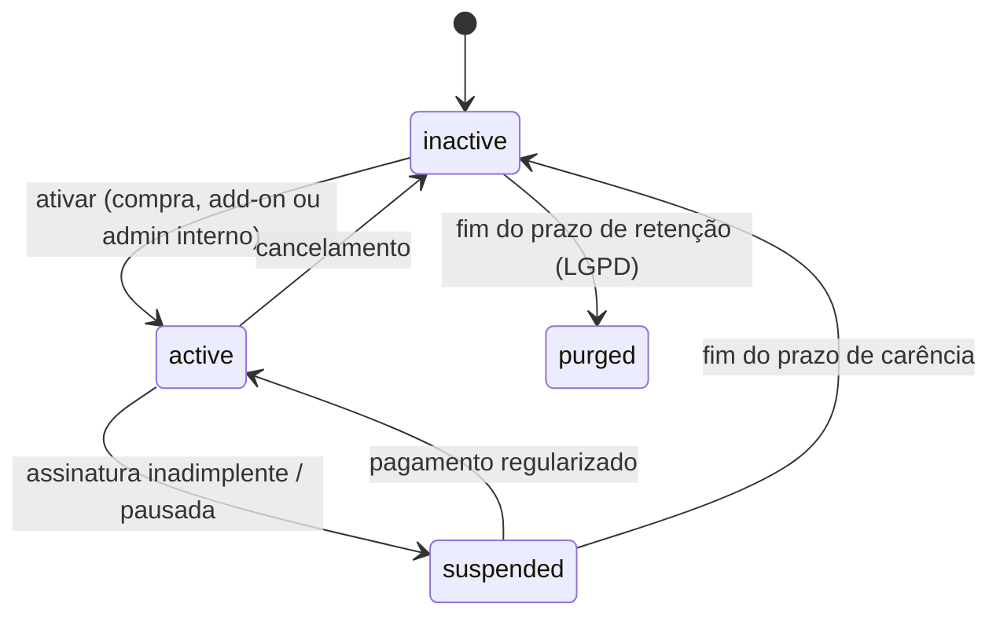

# 02 — Sistema de módulos

## Camadas

| Camada | Ativação | Exemplos | Pode depender de |
|---|---|---|---|
| `core` | Sempre ativa para todo tenant | `core.auth`, `core.users`, `core.access` (permissões), `core.customers`, `core.finance`, `core.segmentation`, `core.audit` | `core` |
| `shared` | Ativada por pacote ou como dependência | `shared.service-orders`, `shared.scheduling`, `shared.medical-records`, `shared.subscriptions`, `shared.inventory`, `shared.notifications` | `core`, `shared` |
| `vertical` | Contratada | `laundry`, `vet`, `dental`, `ortho`, `aesthetics`, `notary`, `gym` | `core`, `shared`, `integration` (opcional) |
| `integration` | Contratada | `integration.shopify`, `integration.nfse`, `integration.payments`, `integration.whatsapp` | `core` |

Os módulos `shared` existem para que **uma funcionalidade usada por várias verticais seja escrita uma vez só**:

| Módulo shared | Usado por |
|---|---|
| `shared.service-orders` | lavanderia, cartório, (ortopedia: órteses) |
| `shared.scheduling` | veterinária, odonto, ortopedia, estética, academia |
| `shared.medical-records` | veterinária, odonto, ortopedia, estética |
| `shared.subscriptions` | academia, lavanderia (planos mensais), estética (pacotes) |
| `shared.inventory` | veterinária, estética, lavanderia (insumos) |
| `shared.notifications` | todos |

**Regra:** um módulo `vertical` nunca importa código de outro `vertical`. Se duas verticais precisam da mesma coisa, ela vira `shared`.

## Manifesto do módulo

Cada módulo exporta um manifesto declarativo. O registry carrega todos os manifestos no boot e valida dependências, permissões duplicadas e ciclos.

```ts
// modules/laundry/src/manifest.ts
import { defineModule } from '@all/module-sdk';
import { z } from 'zod';

export default defineModule({
  key: 'laundry',
  name: 'Lavanderia',
  layer: 'vertical',
  version: '1.0.0',
  dependsOn: ['core.customers', 'core.finance', 'shared.service-orders', 'shared.notifications'],
  optionalDependsOn: ['integration.shopify', 'integration.nfse'],

  permissions: [
    { key: 'laundry.orders.read',    label: 'Ver ordens de serviço' },
    { key: 'laundry.orders.write',   label: 'Criar e editar ordens' },
    { key: 'laundry.orders.status',  label: 'Alterar status de peças/ordens' },
    { key: 'laundry.logistics.manage', label: 'Gerenciar coletas e entregas' },
    { key: 'laundry.catalog.manage', label: 'Gerenciar serviços e preços' },
    { key: 'laundry.reports.read',   label: 'Ver relatórios da lavanderia' },
  ],

  defaultRoles: [
    { key: 'laundry.attendant', label: 'Atendente', permissions: ['laundry.orders.read', 'laundry.orders.write', 'core.customers.read', 'core.customers.write'] },
    { key: 'laundry.operator',  label: 'Operador',  permissions: ['laundry.orders.read', 'laundry.orders.status'] },
  ],

  menu: [
    { label: 'Ordens de serviço', path: '/lavanderia/ordens', icon: 'shirt', permission: 'laundry.orders.read' },
    { label: 'Produção',          path: '/lavanderia/producao', icon: 'kanban', permission: 'laundry.orders.status' },
    { label: 'Serviços e preços', path: '/lavanderia/servicos', icon: 'tag',  permission: 'laundry.catalog.manage' },
  ],

  settings: z.object({
    pricingMode: z.enum(['per_piece', 'per_kg', 'mixed']).default('mixed'),
    defaultTurnaroundHours: z.number().int().default(48),
    requirePhotosOnReceive: z.boolean().default(true),
  }),

  events: {
    publishes: ['laundry.order.received', 'laundry.order.ready', 'laundry.order.delivered'],
    subscribes: ['shopify.order.paid', 'finance.payment.received'],
  },

  segmentationFeatures: ['laundry.avg_days_between_orders', 'laundry.delivery_ratio'],

  shopify: {
    metafieldDefinitions: [/* ver 07-vertical-lavanderia.md */],
  },
});
```

O manifesto é a **única fonte** para:
- a tela de permissões (lista só as permissões dos módulos ativos);
- o menu do admin;
- a vitrine do nível 1 (o produto "add-on" referencia `key`);
- a verificação de acesso na API.

## Ciclo de vida da ativação



| Hook | Quando roda | O que faz |
|---|---|---|
| `onEnable(tenant)` | Na ativação | Cria papéis padrão, settings default e seed (ex.: tipos de peça). Se `integration.shopify` estiver ativo, cria as definições de metacampo |
| `onSuspend(tenant)` | Na suspensão | Acesso **somente leitura**, jobs agendados pausados |
| `onDisable(tenant)` | No cancelamento | Bloqueia o acesso. Os **dados são mantidos** durante o prazo de retenção |
| `onPurge(tenant)` | No fim da retenção | Exclusão definitiva |

Resolução de dependências:
- Ao ativar `laundry`, o sistema ativa automaticamente `shared.service-orders` e `shared.notifications`.
- Um módulo do qual outro módulo ativo depende não pode ser desativado.

## Controle de acesso: dois portões

```
Requisição → AuthGuard (JWT válido?)
           → TenantGuard (usuário é membro do tenant? define app.tenant_id na transação)
           → ModuleGuard (módulo dono da rota está ATIVO para o tenant?)
           → PermissionGuard (usuário tem a permissão exigida?)
           → Controller
```

```ts
@Controller('laundry/orders')
@ModuleRoute('laundry')                       // 403 MODULE_NOT_ENABLED se não contratado
export class LaundryOrdersController {
  @Get()
  @RequirePermission('laundry.orders.read')
  list() { ... }
}
```

**Permissões efetivas** = (permissões dos papéis do usuário) ∩ (permissões dos módulos ativos do tenant). Se um módulo for desativado, as permissões dele deixam de valer sem que nenhum papel precise ser editado.

No admin, `GET /me` devolve `{ user, tenant, modules[], permissions[], menu[] }`. As rotas de cada módulo são carregadas por lazy load, e uma rota de módulo inativo nem chega a ser registrada.

## Comunicação entre módulos

| Necessidade | Mecanismo |
|---|---|
| Vertical precisa de dado do core | Chamada direta ao **serviço público** do módulo (ex.: `CustomersService.findById`). Nunca acessar as tabelas de outro módulo |
| Core ou shared precisa reagir a algo da vertical | **Evento** (o core não importa a vertical) |
| Efeito assíncrono ou externo (e-mail, Shopify, NFS-e) | Evento → **transactional outbox** → SQS → worker |

```ts
// dentro da mesma transação que muda o status
await this.outbox.publish(tx, 'laundry.order.ready', { orderId, customerId });
```

O worker lê a tabela `outbox_events` e publica no SQS. Os consumidores são **idempotentes**, com chave `event_id`.

Pontos de extensão que o core oferece às verticais (registrados no manifesto, sem importação reversa):
- `segmentationFeatures`: features extras para a clusterização;
- `customerTabs`: abas extras na ficha do cliente (ex.: "Pets", "Ordens de serviço");
- `financeSources`: origens de lançamento (ex.: "Ordem de serviço");
- `dashboardWidgets`: cards no dashboard inicial.

## Customização por tenant (sem fork)

| Necessidade | Solução |
|---|---|
| Campo extra num cadastro | `custom_field_definitions` + coluna `custom_fields JSONB` nas entidades extensíveis |
| Comportamento configurável | `settings` do módulo (schema Zod no manifesto) |
| Quem pode fazer o quê | Papéis editáveis pelo admin do tenant |
| Textos de notificação | Templates por tenant em `shared.notifications` |
| Vitrine e checkout | Metacampos e extensões Shopify, alimentados pelo admin |

## Estrutura do monorepo

```
all-systems/
├─ apps/
│  ├─ api/                 # NestJS: HTTP. Importa os módulos (parte api)
│  ├─ worker/              # NestJS standalone: consumidores SQS, outbox, jobs agendados
│  ├─ admin/               # React SPA. Importa os módulos (parte web)
│  └─ shopify-app/         # shopify.app.toml + extensions/ (theme, checkout UI, customer account, functions)
├─ modules/
│  ├─ core/
│  │  ├─ auth/  users/  access/  customers/  finance/  segmentation/  audit/
│  ├─ shared/
│  │  ├─ service-orders/  scheduling/  notifications/  subscriptions/ ...
│  ├─ integrations/
│  │  ├─ shopify/  nfse/  payments/  whatsapp/
│  └─ verticals/
│     └─ laundry/
│        ├─ src/manifest.ts
│        ├─ src/api/        # Nest module, controllers, services
│        ├─ src/db/         # schema Drizzle + migrations do módulo
│        ├─ src/web/        # rotas e telas React
│        └─ src/contracts/  # schemas Zod (DTOs) compartilhados api↔web
├─ packages/
│  ├─ module-sdk/          # defineModule, guards, decorators, registry, outbox
│  ├─ db/                  # conexão, helper de transação com tenant (RLS)
│  ├─ ui/                  # design system do admin
│  └─ config/              # tsconfig, eslint
├─ infra/                  # AWS CDK
└─ docs/
```

Cada módulo é uma **fatia vertical** (banco + API + tela). Para criar uma vertical nova, basta criar uma pasta em `modules/verticals/` e registrá-la. Nenhum arquivo do core muda.

Regras de dependência, verificadas no CI com `eslint-plugin-boundaries` ou `dependency-cruiser`:
- `modules/core/**` não importa `shared|integrations|verticals`;
- `modules/verticals/X` não importa `modules/verticals/Y`;
- um módulo só importa outro pelo `index.ts` público dele.
