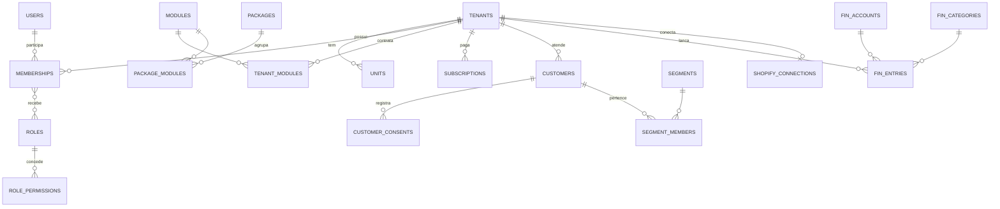

# 03 — Multi-tenancy e dados

## Modelo de isolamento

**Um banco e um schema, com `tenant_id` em toda tabela de negócio e Row-Level Security (RLS) no PostgreSQL.**

- É o modelo mais simples de operar: uma migration roda uma vez e vale para todos.
- Escala bem para centenas ou milhares de tenants pequenos e médios.
- O RLS é uma segunda barreira. Mesmo que um `WHERE tenant_id = ...` seja esquecido no código, o banco não devolve dados de outro tenant.
- Saída futura: se um tenant grande ou regulado (ex.: cartório) exigir isolamento físico, o código suporta apontar esse tenant para outro cluster (`tenants.db_cluster`), sem mudar o modelo.

### Como o RLS é aplicado

```sql
ALTER TABLE customers ENABLE ROW LEVEL SECURITY;
ALTER TABLE customers FORCE ROW LEVEL SECURITY;

CREATE POLICY tenant_isolation ON customers
  USING      (tenant_id = current_setting('app.tenant_id', true)::uuid)
  WITH CHECK (tenant_id = current_setting('app.tenant_id', true)::uuid);
```

- A aplicação conecta com um usuário **sem** `BYPASSRLS` (`app_user`).
- Toda operação de tenant roda dentro de `withTenant(tenantId, tx => ...)`, que executa `SELECT set_config('app.tenant_id', $1, true)` no início da transação. O `true` limita o valor à transação, o que é seguro com pool de conexões.
- Jobs de plataforma, como provisionamento e billing, usam um usuário separado (`platform_user`) e são auditados.
- **Teste obrigatório no CI:** para cada tabela com `tenant_id`, criar dados em dois tenants e garantir que um não enxerga o outro.

## Modelo de dados do core



### Plataforma (sem RLS, acesso só por `platform_user`)

| Tabela | Campos principais |
|---|---|
| `tenants` | id, nome_fantasia, razao_social, cnpj, status (`trial`, `active`, `suspended`, `cancelled`), package_key, db_cluster, created_at |
| `modules` | key, name, layer, version (sincronizado com os manifestos no deploy) |
| `packages` | key, name, vertical, shopify_product_id |
| `package_modules` | package_key, module_key |
| `subscriptions` | id, tenant_id, source (`shopify`, `gateway`, `manual`), external_id (ex.: subscription contract), status, current_period_end, grace_until |
| `users` | id, email (único global), password_hash (argon2id), name, mfa_secret?, email_verified_at, last_login_at |

### Tenant (com RLS)

| Tabela | Campos principais | Observação |
|---|---|---|
| `tenant_modules` | tenant_id, module_key, status, source (`package`, `addon`, `dependency`, `manual`), enabled_at, settings JSONB | |
| `units` | tenant_id, nome, endereço, shopify_location_id? | Filiais |
| `memberships` | tenant_id, user_id, status, unit_ids[] | Um usuário pode pertencer a vários tenants (ex.: dono de duas lavanderias) |
| `roles` | tenant_id, key, label, is_system | `is_system` = papel padrão vindo do manifesto |
| `role_permissions` | role_id, permission_key | |
| `membership_roles` | membership_id, role_id | |
| `refresh_tokens` | user_id, tenant_id, token_hash, expires_at, revoked_at, user_agent, ip | |
| `password_reset_tokens` | user_id, token_hash, expires_at, used_at | Sem RLS de tenant: a senha é do usuário, não do tenant |
| `customers` | tenant_id, tipo (PF/PJ), nome, cpf_cnpj, email, telefone, endereço JSONB, custom_fields JSONB, shopify_customer_id?, created_at | Entidade central. As verticais estendem por FK |
| `customer_consents` | customer_id, finalidade, base_legal, granted_at, revoked_at, origem | LGPD |
| `custom_field_definitions` | tenant_id, entity, key, label, type, required, options | |
| `fin_accounts` | tenant_id, nome, tipo (caixa, banco, gateway) | |
| `fin_categories` | tenant_id, nome, tipo (receita/despesa), parent_id | |
| `fin_entries` | tenant_id, tipo, status (`previsto`, `realizado`, `cancelado`), valor, data_competencia, data_caixa, account_id, category_id, customer_id?, unit_id?, source_type, source_id | Ver [04-core](04-core.md#financeiro) |
| `segments` / `segment_members` / `customer_features` | ver [04-core](04-core.md#clusterização-de-clientes) | |
| `shopify_connections` | tenant_id, shop_domain, access_token (cifrado com KMS), scopes, status, installed_at | Só se `integration.shopify` estiver ativo |
| `external_refs` | tenant_id, entity, entity_id, provider, external_id | Mapeamento genérico de IDs (Shopify, gateway, NFS-e) |
| `outbox_events` | id, tenant_id, type, payload JSONB, created_at, published_at | |
| `inbox_events` | provider, external_event_id (único), received_at, processed_at, error | Idempotência de webhooks |
| `audit_logs` | tenant_id, user_id, action, entity, entity_id, diff JSONB, ip, at | Particionada por mês |
| `files` | tenant_id, s3_key, mime, size, owner_entity, owner_id | |

### Convenções
- PKs em `uuid` v7 (ordenáveis por tempo).
- Toda tabela de tenant tem `tenant_id`, `created_at`, `updated_at` e, quando fizer sentido, `deleted_at` (soft delete).
- Números legíveis ao usuário (nº da OS, nº do pedido) usam **sequência por tenant** (`tenant_sequences`), nunca o id.
- Dinheiro em `numeric(14,2)` ou centavos em `bigint`, **nunca** `float`.
- Datas em `timestamptz` (UTC). A exibição usa o fuso do tenant.
- Cada módulo é dono das suas tabelas, com prefixo (`laundry_*`, `so_*` para service-orders). Outro módulo só lê por meio do serviço público ou de uma view exposta.

## LGPD — base técnica

| Requisito | Implementação |
|---|---|
| Consentimento e base legal | `customer_consents` |
| Direito de acesso e portabilidade | Export JSON/CSV por cliente, agregando todos os módulos (cada módulo implementa `exportCustomerData`) |
| Direito de eliminação | `anonymizeCustomer`, implementado por cada módulo. Também atende o webhook `customers/redact` da Shopify |
| Dados sensíveis (saúde) | Tabelas próprias, permissões específicas e trilha de acesso (quem leu) no módulo `shared.medical-records` |
| Segurança | Criptografia em repouso (RDS/S3 com KMS), TLS, auditoria, menor privilégio |
| Retenção | Prazo configurável por tipo de dado e job de expurgo |

O papel de cada parte: **o tenant é o controlador** dos dados dos clientes dele, e **nós somos operadores**. Isso precisa constar no contrato e nos termos de uso.
