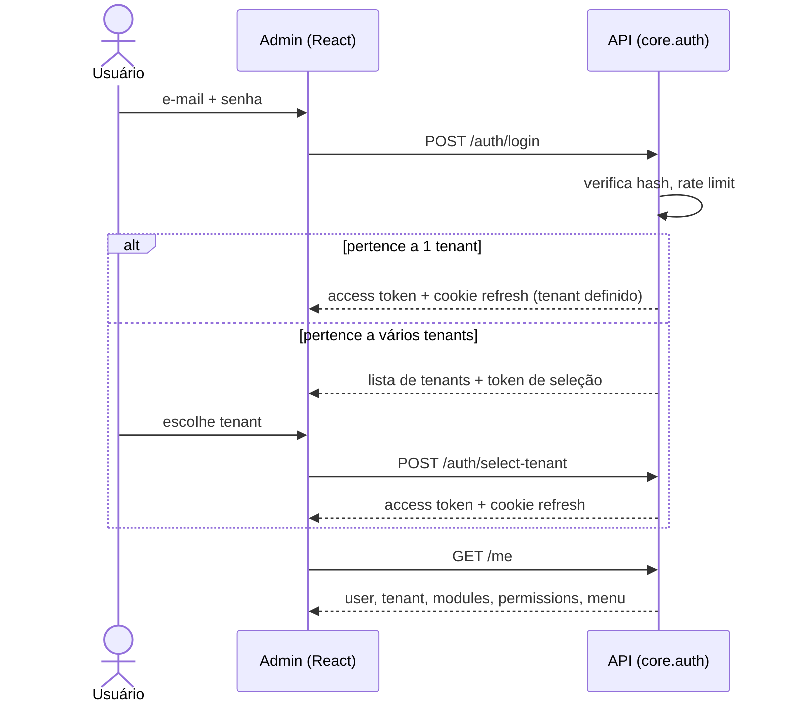

# 04 — Módulos do core

Os módulos do core estão sempre ativos para todo tenant e não conhecem nenhuma vertical.

## Login (`core.auth`)

Autenticação própria em NestJS. A escolha contra Cognito está registrada em [decisões](decisoes.md): o modelo usuário ↔ vários tenants e as permissões por módulo ficam mais simples em casa.

| Item | Decisão |
|---|---|
| Credencial | E-mail + senha. Hash **argon2id** |
| Sessão | **Access token JWT** de 15 min (em memória no admin) + **refresh token** opaco de 30 dias em cookie `httpOnly; Secure; SameSite=Strict`, com **rotação** a cada uso e detecção de reuso (um reuso revoga toda a família de tokens) |
| Escopo do token | O JWT carrega `sub` (user) e `tid` (tenant ativo). Trocar de tenant emite um novo par de tokens |
| Proteções | Rate limit por IP e por e-mail, bloqueio progressivo após falhas, mensagens genéricas ("e-mail ou senha inválidos") |
| MFA | TOTP opcional na fase 1. Pode ser exigido por tenant |
| Futuro | Login com Google e SSO (OIDC) para tenants maiores |



## Cadastro de usuários (`core.users`)

- **Convite por e-mail**: o admin do tenant convida, e o convidado define a senha pelo mesmo mecanismo de token da recuperação de senha.
- Se o e-mail já existir (o usuário já é membro de outro tenant), apenas uma nova `membership` é criada.
- Na membership: ativar/desativar, atribuir papéis e restringir a unidades.
- O **primeiro usuário** do tenant (o dono) é criado no provisionamento ([05](05-integracao-shopify.md#provisionamento)) com o papel `core.owner`, que não pode ser removido enquanto for o único dono.

## Controle de permissões (`core.access`)

- **RBAC**: usuário → papéis → permissões. As permissões são declaradas nos manifestos ([02](02-sistema-de-modulos.md#controle-de-acesso-dois-portões)).
- Papéis de sistema: `core.owner` (tudo), `core.admin` (tudo menos billing e exclusão do tenant), mais os `defaultRoles` de cada módulo ativo.
- O tenant pode **criar papéis próprios** escolhendo permissões numa tela agrupada por módulo. Só aparecem módulos ativos.
- **Escopo por unidade**: se a membership tiver `unit_ids`, as consultas das verticais filtram por unidade (helper `scopeByUnit`).
- Toda alteração de papel ou permissão vai para `audit_logs`.

## Recuperação de senha (`core.auth`)

```mermaid
sequenceDiagram
    actor U as Usuário
    participant API
    participant SES as Amazon SES
    U->>API: POST /auth/forgot { email }
    API->>API: se o e-mail existir: gera token de 32 bytes aleatórios, salva SHA-256 + expira em 30 min
    API->>SES: e-mail com link /reset?token=...
    API-->>U: 200 sempre igual ("se existir, enviamos um e-mail")
    U->>API: POST /auth/reset { token, novaSenha }
    API->>API: valida hash, expiração e uso único; checa força e senha vazada (k-anonymity HIBP)
    API->>API: atualiza a senha, marca o token como usado, REVOGA todos os refresh tokens
    API->>SES: e-mail "sua senha foi alterada"
```

- A resposta e o tempo de resposta são iguais exista ou não o e-mail, para não revelar quais e-mails estão cadastrados.
- Rate limit de 3 pedidos por e-mail por hora e outro limite por IP.
- O mesmo fluxo serve para o **convite** (token com 7 dias de validade e propósito `invite`).

## Clientes (`core.customers`)

É a entidade central que todas as verticais usam. A ficha do cliente tem:
- dados cadastrais (PF/PJ), contatos, endereços, `custom_fields`;
- consentimentos LGPD;
- **abas de extensão** registradas pelas verticais (Lavanderia: "Ordens de serviço"; Veterinária: "Pets");
- **linha do tempo** alimentada por eventos de todos os módulos (OS criada, pagamento, notificação enviada);
- segmento atual (vindo de `core.segmentation`);
- vínculo com a Shopify (`shopify_customer_id`), quando a integração está ativa.

Deduplicação: busca por CPF/CNPJ, e-mail e telefone normalizado (E.164) antes de criar. Existe também uma tela de **mesclagem** de cadastros duplicados.

## Financeiro

`core.finance` cobre um **financeiro gerencial** (não é contabilidade). Exporta dados para o contador.

**Um único livro de lançamentos (`fin_entries`)** alimentado por várias origens:

| Origem (`source_type`) | Como entra |
|---|---|
| `manual` | Lançado na tela (despesas, receitas avulsas) |
| `shopify_order` | Webhook `orders/paid` da loja do cliente → receita realizada. `refunds/create` → estorno |
| `service_order` | Evento de shared.service-orders ao faturar a OS → receita prevista ou realizada |
| `gateway_charge` | Cobrança Pix/boleto pelo `integration.payments` → prevista, e realizada na confirmação |
| `subscription` | Mensalidades (academia, planos da lavanderia) |
| `fee` | Taxas (Shopify, gateway) como despesa, para a margem ficar real |

**Relatórios** (fase 1):
- Fluxo de caixa (realizado e previsto) por período, conta e unidade
- DRE gerencial simplificado (receitas − deduções/taxas − despesas por categoria)
- Contas a receber e a pagar, com vencidos
- Faturamento por canal (balcão, loja online, POS), por serviço e por unidade
- Ticket médio e receita por cliente (alimenta a clusterização)

As agregações pesadas usam **views materializadas** atualizadas por job, e a exportação é em CSV/XLSX.

## Clusterização de clientes (`core.segmentation`)

O módulo é feito em duas etapas, começando pelo que é explicável ao dono do negócio.

### Etapa 1 — RFM com regras (fase inicial)
Um job noturno calcula `customer_features` por cliente:
- **R**ecência: dias desde a última compra ou serviço
- **F**requência: nº de compras nos últimos 12 meses
- **M**onetário: valor total nos últimos 12 meses
- ticket médio, canal preferido, tempo de casa
- **features das verticais**, registradas no manifesto (ex.: `laundry.avg_days_between_orders`)

Os clientes recebem scores de 1 a 5 em R, F e M e são mapeados em segmentos fixos: **Campeões, Leais, Promissores, Novos, Em risco, Hibernando, Perdidos**. Cada segmento vem com uma ação sugerida (ex.: "Em risco: enviar cupom de retorno").

### Etapa 2 — clusterização estatística (posterior)
- K-means ou K-prototypes sobre as features normalizadas, rodando como **ECS scheduled task em Python**. É a única peça fora de TypeScript, isolada e lendo de uma réplica.
- Rótulos dos clusters sugeridos automaticamente pelas features dominantes e editáveis pelo tenant.
- Requer volume mínimo de clientes por tenant. Abaixo disso, fica só o RFM.

### Uso dos segmentos
- Filtros e listas no admin, com exportação
- Gatilhos em `shared.notifications` (campanhas)
- **Com `integration.shopify` ativa**: o segmento é sincronizado como **tag** e **metacampo** do cliente na loja do tenant, o que permite segmentos de clientes e descontos direcionados na própria Shopify

## Auditoria (`core.audit`)

Interceptor global que registra as mutações (quem, o quê, antes/depois, IP), com uma tela de consulta para o `core.owner`. A tabela é particionada por mês, com retenção configurável.
