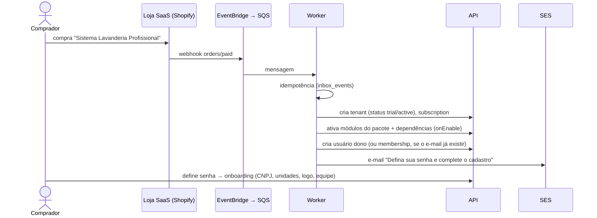

# 05 — Integração Shopify

A Shopify aparece em dois papéis independentes:

| | Nível 1 — Loja SaaS | Nível 3 — Loja do cliente |
|---|---|---|
| Dono da loja | Nós | O tenant |
| Quantidade | 1 | 0 ou 1 por tenant |
| Vende | Pacotes e add-ons do All Systems | Serviços e produtos do tenant ao consumidor final |
| Integração | App personalizado na nossa loja | Módulo `integration.shopify` (app instalado na loja do tenant) |
| Gera no admin | Tenant, assinatura, módulos ativos | Pedidos → OS, lançamentos financeiros, clientes |

> ⚠️ Vários pontos abaixo dependem de regras comerciais e de plano da Shopify que mudam com frequência. Os itens com **[validar]** estão listados na Fase 0 do [roadmap](08-roadmap-e-riscos.md).

---

## Nível 1 — Loja SaaS

### Catálogo
| Produto Shopify | Variantes | Metacampos (`allsystems.*`) |
|---|---|---|
| Sistema Lavanderia | Essencial / Profissional | `package_key`, `modules` (lista de keys), `max_users`, `max_units` |
| Sistema Veterinária | Essencial / Profissional | idem |
| Add-on: Integração Shopify | — | `modules = ["integration.shopify"]` |
| Add-on: Emissão de NFS-e | — | `modules = ["integration.nfse"]` |
| Add-on: Unidade extra | — | `extra_units = 1` |

Na página do produto, os metacampos também alimentam a **tabela comparativa de funcionalidades**, gerada a partir dos manifestos. Assim o que a loja promete é o mesmo que o sistema ativa.

### Cobrança recorrente
Opção A: **Selling plans** (assinatura) com um app de assinaturas ou a API de Subscription Contracts.

**[validar — risco alto]** Cobrança recorrente no checkout exige um gateway que suporte pagamentos com cartão salvo para assinaturas na Shopify. Até onde sabemos, o Shopify Payments não está disponível no Brasil, e poucos gateways de terceiros suportam assinaturas na plataforma. **Plano B**, já previsto na arquitetura:
- a Shopify vende o **plano anual** (pagamento único) ou a **primeira mensalidade**;
- as recorrências seguintes são cobradas por um **gateway de recorrência brasileiro** (cartão, Pix automático, boleto) pelo módulo `integration.payments`, e `subscriptions.source = 'gateway'`.

### Provisionamento



- **CNPJ e razão social são coletados no onboarding**, depois da compra, e não no checkout. Campos extras nas etapas de informação do checkout exigem Shopify Plus.
- A página de obrigado (checkout UI extension, disponível em todos os planos) mostra o link "Acessar meu sistema".
- **Add-on comprado depois** → `orders/paid` com `customer_id` já vinculado a um tenant → ativa só o módulo do add-on.
- **Cancelamento ou inadimplência** (`subscription_contracts/update`, ou webhook do gateway no plano B) → `suspended` com carência configurável → `inactive`.

---

## Nível 3 — Loja do cliente (`integration.shopify`)

### Distribuição do app — **[validar — decisão pendente]**

| Opção | Prós | Contras |
|---|---|---|
| **App público** (App Store, listado ou não) | Um app só para todos os tenants, deploy único das extensões, Functions em qualquer plano | Revisão da Shopify, webhooks de compliance obrigatórios. **Cobrança pelo app passa pela Billing API** (conflita com cobrar o add-on na nossa loja) |
| **Distribuição personalizada** | Sem revisão da App Store e com cobrança livre | Instalação restrita a uma loja (ou organização Plus) por app, o que significa **um app por tenant**. Functions em app personalizado exigem Plus |

Recomendação provisória: **app público** e, se a política exigir, cobrar o add-on pela Billing API em vez da nossa loja. Isso precisa ser confirmado com a Shopify na Fase 0 antes de qualquer código.

### Conexão
1. No admin, o tenant clica em **"Conectar minha loja Shopify"** e informa `minhaloja.myshopify.com`.
2. Fluxo OAuth de instalação. O token offline é guardado cifrado com KMS em `shopify_connections`.
3. `onEnable` do módulo e das verticais ativas: cria **definições de metacampos e metaobjetos**, registra webhooks e ativa a theme app extension.
4. Importação inicial (Bulk Operations): clientes e produtos existentes → `external_refs`.
5. `app/uninstalled` → conexão marcada como `disconnected`. Os dados no admin são mantidos.

### Webhooks

```
Shopify ──► Amazon EventBridge (partner event source) ──► regra por tópico ──► SQS (+ DLQ) ──► worker
```

| Tópico | Ação no admin |
|---|---|
| `orders/paid` | Lançamento financeiro e evento `shopify.order.paid`. As verticais decidem o que fazer (Lavanderia: cria OS) |
| `orders/cancelled`, `refunds/create` | Estorno no financeiro e evento para as verticais |
| `orders/fulfilled` | Conferência |
| `customers/create`, `customers/update` | Upsert em `customers`, com dedup |
| `products/update` | Detecta edição manual na Shopify de produto gerenciado pelo admin e alerta |
| `app/uninstalled` | Desconecta |
| `customers/data_request`, `customers/redact`, `shop/redact` | **Compliance obrigatório**: export ou anonimização |

Garantias:
- **Idempotência**: `inbox_events.external_event_id` único (id do evento/webhook da Shopify).
- **Ordem não garantida**: comparar o `updated_at` do payload com o registro local antes de sobrescrever.
- **Reconciliação**: um job a cada hora consulta pedidos e clientes alterados desde a última sincronização via GraphQL, porque webhooks podem falhar.
- **Rate limit**: as chamadas à Admin GraphQL API passam por uma fila com controle de custo **por loja**.

### Direção da sincronização

| Entidade | Fonte da verdade | Direção |
|---|---|---|
| Catálogo de **serviços** (ex.: "Lavar e passar camisa") | Admin | Admin → Shopify (produto + metacampos) |
| **Produtos físicos** (ex.: venda de sabão, ração) | Shopify | Shopify → admin (só leitura e relatórios) |
| Pedidos | Shopify | Shopify → admin |
| Clientes | Admin (dados cadastrais e consentimento) | Bidirecional, com mapeamento em `external_refs` |
| Status da OS | Admin | Admin → metacampo do pedido (exibido ao cliente final) |
| Segmento do cliente | Admin | Admin → tag e metacampo do cliente |

### Metacampos — regras

1. **Namespace reservado do app** (`$app:allsystems`). O lojista não consegue editar ou apagar por engano.
2. **Só o que a vitrine, o checkout ou a conta do cliente precisam ler.** Todo o resto fica no Postgres.
3. **Nunca dados sensíveis**: saúde, prontuário, documentos de cartório, CPF.
4. Definições criadas no `onEnable` a partir do manifesto do módulo (`shopify.metafieldDefinitions`).
5. Metaobjetos para conteúdo estruturado exibido na loja (ex.: tabela de preços por tipo de peça, FAQ do serviço).

### Extensões Shopify (em `apps/shopify-app/extensions/`)

| Extensão | Disponibilidade | Uso |
|---|---|---|
| **Theme app extension** | Todos os planos | Bloco "Agendar coleta" na página do produto e na de carrinho (grava atributos do carrinho), bloco "Acompanhe sua OS" |
| **Customer account UI extension** | Todos os planos (contas de cliente novas) | Página "Minhas ordens de serviço" com status em tempo real (lido da nossa API) |
| **Checkout UI — página de obrigado / status do pedido** | Todos os planos | Confirmação da janela de coleta, nº da OS |
| **Checkout UI — etapas de informação/entrega/pagamento** | **Somente Plus** | Evitar dependência; usar atributos do carrinho capturados antes do checkout |
| **Shopify Functions** (desconto, validação de carrinho) | Ver tabela de distribuição | Ex.: desconto automático para o segmento "Em risco", validação de pedido mínimo |
| **POS UI extension** | Shopify POS | Abrir ou consultar a OS no balcão |

### Pagamentos no Brasil — **[validar]**
- Gateway de terceiros com Pix e cartão parcelado na loja do tenant. O tenant escolhe e configura, e a escolha é dele.
- A Shopify cobra **taxa adicional por transação** quando o gateway não é o Shopify Payments. O percentual depende do plano. Essa taxa entra como `fee` no financeiro para a margem ser real.
- **Diferença de valor após a conferência** (ex.: o peso real da roupa é maior que o estimado): gerar um **draft order com link de pagamento (invoice)** na Shopify, ou cobrança Pix pelo `integration.payments`. Ver [07](07-vertical-lavanderia.md).
