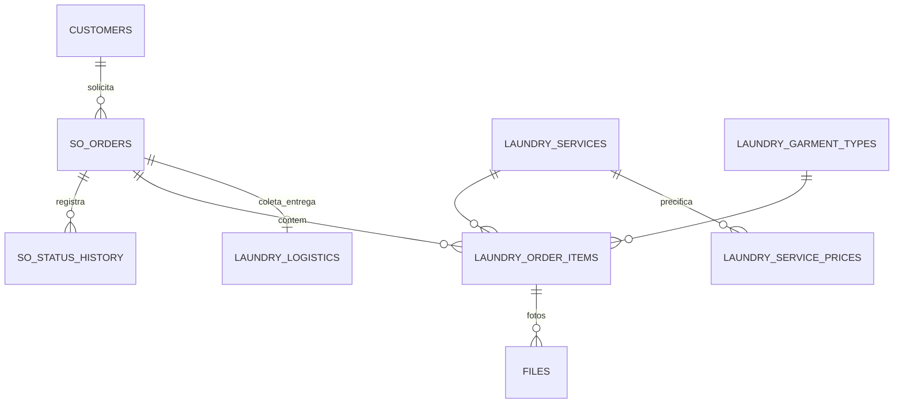
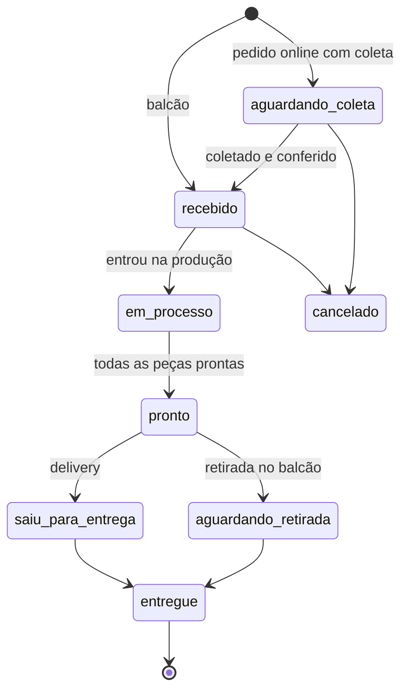
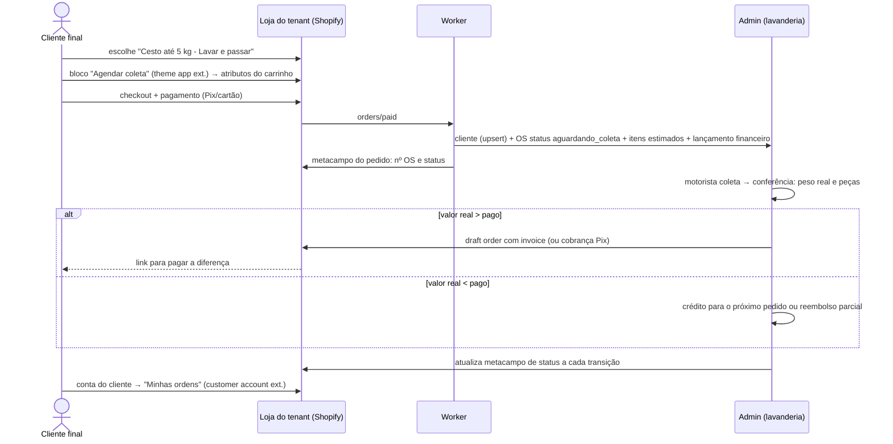
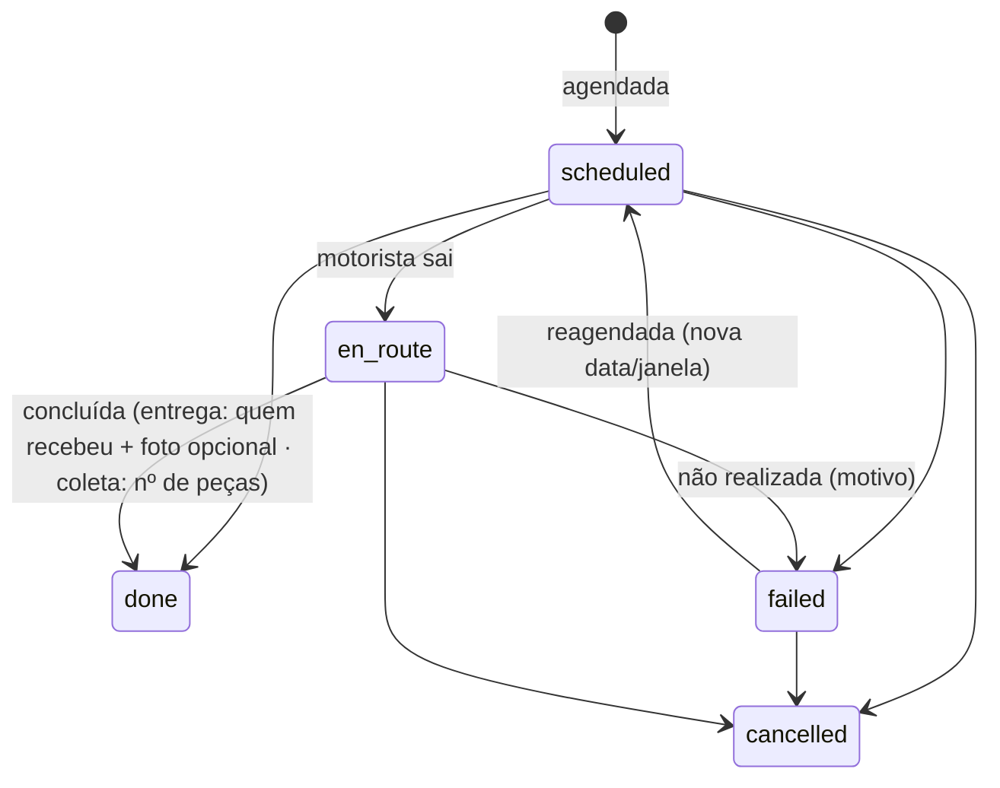

# 07 — Vertical Lavanderia (`laundry`)

Primeira vertical a ser construída. Ela valida o sistema de módulos, o `shared.service-orders`, o financeiro e, opcionalmente, a integração com a loja Shopify do tenant.

## Pacotes

| Pacote | Módulos |
|---|---|
| **Lavanderia Essencial** | core + `shared.service-orders` + `shared.notifications` + `laundry` |
| **Lavanderia Profissional** | Essencial + `integration.payments` (Pix) + `integration.whatsapp` + até 3 unidades |
| Add-ons | `integration.shopify` (loja online e delivery), `integration.nfse`, `shared.subscriptions` (planos mensais, fase 2), unidade extra |

## O que vem do shared e o que é da vertical

**`shared.service-orders`** (genérico, reaproveitado depois pelo cartório):
- OS com número sequencial por tenant, cliente, unidade, canal, status, prazo, valor e situação de pagamento
- Máquina de estados **configurável pela vertical**, com histórico (`so_status_history`)
- Anexos (S3), observações internas e para o cliente
- Faturamento da OS → evento para `core.finance`

**`laundry`** (específico):
- Catálogo de serviços com modo de cobrança (peça, kg, m²)
- Itens da OS **por peça**: tipo, cor, marca, avarias, fotos, etiqueta
- Status por peça e quadro de produção (kanban)
- Coleta e entrega (delivery)
- Relatórios operacionais da lavanderia

> **Ajuste da Fase 2:** os itens da OS ficam no `shared.service-orders` (`so_items`, genérico, com
> `ref_type/ref_id` apontando para o serviço da lavanderia). Os dados por peça (cor, marca, avaria,
> fotos, etiqueta, status da peça) entram na Fase 3 como extensão 1:1 do item (`laundry_item_details`)
> em vez de uma tabela de itens paralela. Assim totais, pagamentos e financeiro ficam num só lugar.
> A lavanderia registra o próprio fluxo de status via `ServiceOrderWorkflows.register(...)`.

## Modelo de dados

| Tabela | Campos principais |
|---|---|
| `so_orders` (shared) | tenant_id, number, customer_id, unit_id, channel (`counter`, `online`, `pos`, `whatsapp`), status, received_at, due_at, delivered_at, subtotal, discount, total, paid_amount, payment_status (`pending`, `partial`, `paid`), external_order_id?, notes_internal, notes_customer |
| `so_status_history` (shared) | order_id, from, to, user_id, at, reason |
| `laundry_services` | tenant_id, name (ex.: "Lavar e passar"), pricing_unit (`piece`, `kg`, `sqm`), turnaround_hours, active, shopify_product_id? |
| `laundry_service_prices` | service_id, garment_type_id? (null = preço por kg/m²), price |
| `laundry_garment_types` | tenant_id, name (camisa, calça, edredom, tapete…), seed padrão no `onEnable` |
| `laundry_order_items` | order_id, service_id, garment_type_id, quantity, weight_kg?, area_sqm?, color, brand, damage_notes, tag_code (QR/etiqueta), item_status, unit_price, total |
| `laundry_logistics` | order_id, pickup_address, pickup_window_start/end, delivery_address, delivery_window_start/end, driver_user_id?, pickup_status, delivery_status, fee |

## Estados

O **status por peça** (`laundry_order_items.item_status`) segue: `recebida → lavagem → secagem → passadoria → pronta`, com desvios `retrabalho` e `avaria`. A OS passa para `pronto` automaticamente quando **todas** as peças estão `pronta`.

| Transição | Notificação ao cliente (WhatsApp/e-mail) |
|---|---|
| → `recebido` | "Recebemos suas N peças. Previsão: dd/mm hh:mm" + link de acompanhamento |
| peça → `avaria` | "Identificamos uma avaria na peça X", com foto. Exige confirmação |
| → `pronto` | "Seu pedido está pronto" + valor em aberto e link de pagamento |
| → `saiu_para_entrega` | "Saiu para entrega" + janela |
| prazo estourado | Alerta **interno** ao gerente antes de estourar |

## Fluxos

### 1. Balcão (sem Shopify)
1. O atendente busca ou cadastra o cliente (dedup por telefone).
2. Cria a OS e adiciona as peças: tipo, serviço, cor, observações e **fotos das avarias pré-existentes**. Com `requirePiecePhotos` ligado, a peça sem foto não sai de "Recebida" (a ordem abre antes, porque a foto precisa da peça).
3. O sistema calcula o total e o prazo (maior `turnaround_hours` entre os serviços).
4. Imprime o **comprovante** (com QR do acompanhamento) e as **etiquetas** das peças (`tag_code`).
5. Pagamento na entrada ou na retirada: dinheiro, maquininha (registro manual) ou **Pix** (`integration.payments`, com baixa automática por webhook do gateway).
6. A produção move as peças no kanban → a OS fica `pronto` → notificação → retirada com conferência do código.

### 2. Online com coleta (`integration.shopify` ativo)

### 3. Balcão com Shopify POS (opcional)
A venda é feita no POS da Shopify e o `orders/paid` com `source_name = pos` gera a OS com `channel = pos`. A POS UI extension mostra as OS em aberto do cliente.

## Integração Shopify — específico da lavanderia

| Onde | Metacampo (`$app:allsystems`) | Tipo | Uso |
|---|---|---|---|
| Produto | `laundry_service_key` | single_line_text | Liga o produto ao `laundry_services` |
| Produto | `pricing_unit` | single_line_text (`piece`/`kg`/`sqm`) | Vitrine mostra "por peça" ou "por kg" |
| Produto | `turnaround_hours` | number_integer | Vitrine mostra o prazo |
| Pedido | `service_order_number` | single_line_text | Exibido na conta do cliente |
| Pedido | `service_order_status` | single_line_text | Status para a conta do cliente e a página de status do pedido |
| Cliente | `segment` | single_line_text | Segmento RFM (ver [04](04-core.md#clusterização-de-clientes)) |
| Metaobjeto | `laundry_price_table` | — | Tabela de preços por tipo de peça exibida na loja |

Não vão para a Shopify: fotos das peças, observações de avaria, endereço do motorista ou dados de produção.

## Permissões e papéis padrão

| Permissão | Dono | Atendente | Operador | Motorista |
|---|:-:|:-:|:-:|:-:|
| `laundry.orders.read` | ✓ | ✓ | ✓ | |
| `laundry.orders.write` | ✓ | ✓ | | |
| `laundry.orders.status` | ✓ | ✓ | ✓ | |
| `laundry.logistics.manage` (agendar, atribuir, reagendar, cancelar) | ✓ | ✓ | | |
| `laundry.logistics.drive` (minhas rotas: só as atribuídas) | ✓ | ✓ | | ✓ |
| `laundry.catalog.manage` | ✓ | | | |
| `laundry.reports.read` | ✓ | | | |

O motorista não lê ordens nem clientes: cada tarefa da rota já traz o que ele precisa (nome, telefone,
endereço, nº e saldo da ordem, taxa).

## Relatórios da vertical
- Peças processadas por dia, etapa e operador (produtividade)
- **% de OS entregues no prazo** e tempo médio por etapa (gargalos)
- Peças com avaria e retrabalho (qualidade)
- Receita por serviço, canal e unidade (vem do core.finance, filtrado por `source_type = service_order` ou `shopify_order`)
- Coletas e entregas por janela e motorista

## Features para a clusterização
- `laundry.avg_days_between_orders`: intervalo médio entre OS
- `laundry.avg_pieces_per_order` e `laundry.avg_kg_per_order`
- `laundry.delivery_ratio`: % de pedidos com coleta/entrega
- `laundry.top_service`: serviço mais usado

## Implementado na Fase 3

| Item | Onde |
|---|---|
| Tabelas `laundry_garment_types`, `laundry_service_prices`, `laundry_item_details` (1:1 com `so_items`), `laundry_piece_events` | `modules/verticals/laundry/src/db/schema.ts` |
| Fluxo `laundry` (Recebida → Em produção → Pronta → Saiu para entrega/Entregue), com veto de "Pronta" se houver peça em produção | `src/api/workflow.ts` |
| A ordem anda sozinha conforme as peças; retrabalho volta a ordem para a produção | `LaundryOrdersService.syncOrderStatus` |
| Telas: Balcão, ordem com peças/fotos/ocorrências/pagamento, etiquetas, comprovante, Produção, Relatórios, Serviços e tipos de peça | `src/web/` |

### Coleta e entrega (versão 0.4.0 do módulo)

Uma tabela só, `laundry_logistics_jobs` (em vez do `laundry_logistics` 1:1 com a ordem do desenho acima):
cada linha é uma **coleta** (`pickup`) ou uma **entrega** (`delivery`), com cliente, ordem (obrigatória na
entrega; na coleta é ligada depois, no balcão), endereço (copiado do cadastro do cliente, editável),
dia + janela (período manhã/tarde/noite ou horário de/até), taxa, motorista, observações e o comprovante.

| Evento da tarefa | Efeito na ordem (`shared.service-orders`) | Aviso ao cliente |
|---|---|---|
| Entrega agendada ("Entregar no endereço", ordem recebida/em produção/pronta) | — | `laundry.delivery.scheduled` |
| Coleta agendada | — | `laundry.pickup.scheduled` |
| Motorista sai — entrega (exige ordem Pronta) | `ready → out_for_delivery` | `laundry.order.out_for_delivery` (do fluxo) |
| Motorista sai — coleta | — | `laundry.pickup.on_the_way` |
| Entrega concluída | `out_for_delivery → delivered` | `laundry.order.delivered` (do fluxo) |
| Entrega não realizada / cancelada depois de sair | `out_for_delivery → ready` (motivo no histórico) | `laundry.order.ready` (do fluxo) |
| Coleta concluída | — (o balcão abre a ordem com `pickupJobId` ou liga depois em `link-order`) | — |

Reagendar notifica de novo (`*.scheduled`). Uma entrega em aberto por ordem (índice único parcial).

**Registrar depois o que já aconteceu:** a tarefa pode ser criada num dia que já passou, e sair, concluir e
"não realizada" aceitam `occurredAt` (nunca no futuro; informado, nunca antes do dia da tarefa; sempre
depois da saída e da última tentativa que falhou, guardada em `failed_at`; a entrega, nunca antes da
entrada da ordem). A ordem muda de status com esse horário (histórico e `closed_at`), a taxa recebida na
conclusão entra no financeiro naquele dia, e o cliente não é avisado de evento com mais de 30 minutos nem
de tarefa criada/remarcada para um dia que já passou. Remarcar para um dia que já passou só vale para a
tarefa "não realizada" (a nova tentativa, a partir do dia da que falhou); a agendada que ainda não
aconteceu não volta para o passado — para registrar uma coleta/entrega antiga, cria-se outra com a data
passada.

**Taxa:** vira um "a receber" próprio no financeiro (`source_type = laundry_logistics`, um por tarefa,
`settle_in_finance`), não um item da ordem. Motivos: `ServiceOrdersService.update` troca todos os
`so_items` (e o `laundry_item_details` de cada peça cai em cascata); o serviço não tem como só acrescentar
um item e recalcular; e a coleta tem taxa antes de existir ordem. O motorista pode dar baixa na hora
(`feeMethod` ao concluir); senão a baixa é feita no financeiro. Taxas padrão em `settings.pickupFee/deliveryFee`.

Telas: **Coletas e entregas** (`/lavanderia/logistica`, por dia e motorista, filtros, atribuir, reagendar,
cancelar, "Abrir ordem no balcão" para coleta concluída, taxas padrão), **Minhas rotas**
(`/lavanderia/minhas-rotas`, celular: mapa, ligar, WhatsApp, sair/concluir/não realizada, foto) e o cartão
**Entrega** na ordem.

Diferenças em relação ao desenho acima: o status da peça é linear (recebida → lavagem → secagem → passadoria → pronta); retrabalho é voltar de etapa (contado em `rework_count`) e avaria virou **ocorrência**, com aviso ao cliente, em vez de um status. O estado `aguardando_coleta` entra com a loja online (Fase 5).

## MVP (o que entra primeiro)
**Entra:** catálogo de serviços, OS de balcão com peças, fotos e etiquetas, kanban de produção, notificações por e-mail, pagamento manual e Pix, relatórios de prazo e receita.
**Depois:** Shopify (online e coleta), WhatsApp, planos mensais, NFS-e automática. (Motorista/rotas: feito, ver "Coleta e entrega".)
