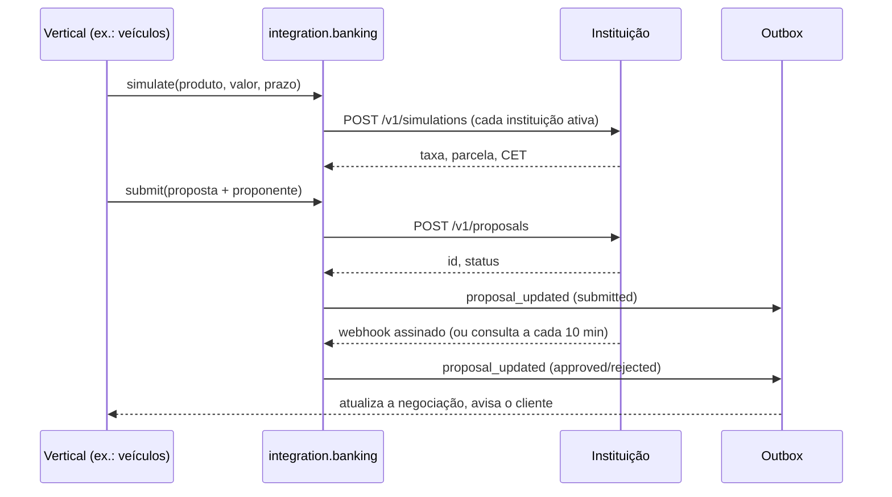

# 10 — Integração bancária (crédito e consórcio)

Módulo `integration.banking`. Atende a revenda de veículos, a imobiliária e o consórcio: simula em várias instituições, envia a proposta na escolhida e acompanha a resposta. As verticais nunca falam com banco diretamente; elas reagem ao evento `integration.banking.proposal_updated`.

## O que é real e o que depende de parceria

Nenhum banco, financeira ou administradora brasileira expõe originação de crédito ou adesão a consórcio sem **contrato comercial de parceria** (correspondente bancário, convênio de lojista ou integrador credenciado). Por isso o módulo tem dois modos por instituição:

| Modo | Para quê | Como funciona |
|---|---|---|
| `simulated` | Demonstração, treinamento e testes | Taxas configuradas na tela. Matemática real: Price ou SAC, IOF estimado, tarifa e CET pela TIR. A decisão é automática: aprova se a parcela cabe em 30% da renda declarada. O consórcio devolve grupo e cota. |
| `api` | Produção, com contrato assinado | Chama a API REST da instituição (ou de um integrador que fala com várias) no contrato abaixo, com OAuth2 *client credentials*. |

Quem tiver uma API diferente entra com um **adaptador**: uma classe com a interface `BankProvider` (`simulate`, `submit`, `status`, `consortiumPlans`), registrada ao lado do `RestProvider`. O resto do sistema não muda.

## Fluxo

## Contrato da API REST (modo `api`)

Base: `baseUrl` da conexão. Todas as chamadas (menos o token) levam `Authorization: Bearer <token>`.

| Chamada | Corpo | Resposta |
|---|---|---|
| `POST /oauth/token` (Basic `clientId:clientSecret`, form `grant_type=client_credentials`) | — | `{ access_token, expires_in }` |
| `POST /v1/simulations` | `{ product, amount, termMonths, system?, assetValue? }` | `{ monthlyRate, yearlyRate?, firstInstallment, lastInstallment?, totalPaid, cetYearly, system, fees?: { iof, tac } }` |
| `POST /v1/proposals` | `{ reference, product, amount, termMonths, system?, applicant, details, offer }` | `{ id, status, message?, result? }` |
| `GET /v1/proposals/{id}` | — | `{ status, message?, result? }` |
| `GET /v1/consortium/plans` | — | `{ plans: [{ externalId, name, assetType, creditValue, termMonths, adminFeePercent, reserveFundPercent, insurancePercent }] }` |

`product`: `vehicle_financing`, `real_estate_financing` ou `consortium`. Os status aceitam inglês ou português (`approved`/`aprovada`, `rejected`/`recusada`, `contracted`/`contratada`…). O que não for reconhecido vira "em análise".

### Webhook

`POST {API}/api/public/banking/webhook/{connectionId}` com o corpo `{ proposalId, status, message?, result? }` e o cabeçalho `X-Signature: sha256=<HMAC-SHA256 do corpo com o segredo do webhook>`. Assinatura errada responde 401. Proposta desconhecida responde 200 sem efeito.

## Dados e LGPD

- As credenciais (`clientSecret`, segredo do webhook) ficam cifradas com a chave de configurações e nunca voltam para a tela.
- O proponente (nome, CPF, renda) é gravado na proposta porque foi enviado à instituição. Ele entra na exportação do titular e é anonimizado junto com o cliente. A proposta fica como registro da operação.
- A tabela `bank_webhook_routes` (conexão → empresa) não tem RLS, como a do WhatsApp: o webhook chega sem tenant.

## Limites conhecidos

- O envio da proposta acontece dentro da transação da API. Se a instituição aceitar e a gravação falhar depois, sobra uma proposta só do lado dela. O protocolo (`reference` = id da proposta) permite conciliar.
- IOF estimado sobre o total (o oficial é por parcela). Serve para comparar ofertas; o valor que vale é o da instituição.
