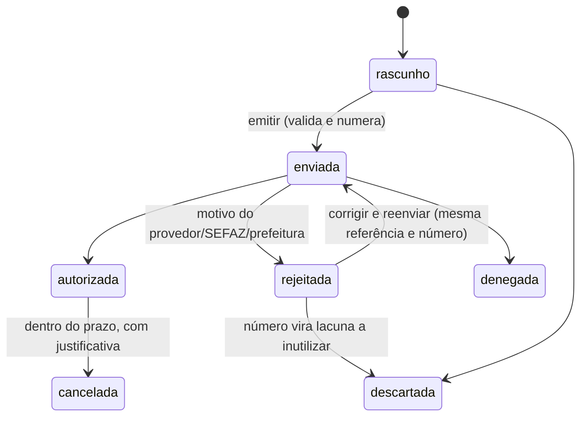

# 11 — Nota fiscal (integração com provedor de emissão)

Módulo `integration.fiscal` (pacote `@all/fiscal`, pasta `modules/integrations/fiscal`). Emite **NFS-e** (serviços), **NFC-e** (venda no caixa) e **NF-e** (mercadoria) por um **provedor de emissão** com API única. Falar direto com 27 SEFAZ e mais de 5.500 prefeituras não é viável; o provedor faz esse papel (ADR-033).

## O que é real e o que depende de contrato

| Provedor | Situação | Uso |
|---|---|---|
| `simulated` | Pronto | Demonstração, treinamento e testes. Autoriza ou rejeita de forma previsível e gera XML/PDF ilustrativos ("SEM VALOR FISCAL"). Só em homologação |
| `focus` (Focus NFe) | Adaptador pronto, campos parcialmente "a confirmar" | Homologação e produção, com contrato e token por empresa |
| `plugnotas`, `nfeio` | Esqueleto documentado | Entram implementando a interface `FiscalProvider` (rotas e autenticação descritas no código) |

O resto do sistema não muda ao trocar de provedor: telas, regras, numeração, arquivos e relatórios são do módulo.

## Fluxo

- **Emitir** valida a configuração e a nota (lista do que falta), reserva o número da série (quando o sistema numera) e publica `integration.fiscal.transmit` no **outbox**. O handler chama o provedor e aplica a resposta. NFC-e costuma voltar autorizada na hora; NFS-e e NF-e voltam "processando" e são resolvidas pelo **webhook** do provedor, pelo job `fiscal.poll` (5 min) ou pelo botão "Atualizar situação".
- **Falha de comunicação** (rede, 5xx, 429) deixa a nota "enviada" e o job tenta de novo; o provedor reconhece a mesma referência, então não duplica. Falha que reenviar não resolve (token errado, adaptador indisponível) devolve a nota como rejeitada, código `CONFIG`.
- **Webhook**: `POST /api/public/fiscal/webhook/{tenantId}` com o segredo no cabeçalho `X-Fiscal-Token` (gerado na tela). Só a `ref` do corpo é usada: a situação é consultada de novo no provedor.
- **Cancelamento**: NFC-e até 30 min, NF-e até 24 h (prazos fixos), NFS-e conforme a configuração (`nfseCancelDays`, varia por município). Justificativa de 15 a 255 caracteres.
- **Carta de correção** (NF-e): 15 a 1000 caracteres, até 20 por nota.
- **Inutilização** (NFC-e/NF-e): de números pulados; a tela mostra as lacunas da série.
- **Contingência**: o retorno do provedor marca a nota (`contingency`) e a tela mostra o selo.
- **Arquivos**: XML, DANFE/DANFSe e XML do cancelamento vão para o storage (R2) pela tabela `files`, com dono `fiscal_document`, fora do download genérico. Download só com `integration.fiscal.export` e registrado na auditoria e no histórico da nota. A aplicação não apaga notas nem o histórico (REVOKE na migration): guarda de 5 anos.
- **Envio ao cliente**: ao autorizar (se ligado), `integration.fiscal.deliver` manda e-mail e/ou WhatsApp com links públicos assinados (HMAC por nota) para o PDF e o XML.

## Origens (sem acoplar nos outros módulos)

A integração não importa os módulos `shared` (regra de camadas). Ela consome eventos do outbox e guarda uma cópia do que a nota precisa em `fiscal_sources`:

| Evento | Publicado por | Payload (resumo) | Vira |
|---|---|---|---|
| `shared.sales.sale_completed` | `SalesService.sellInTx` | venda, cliente, itens (produto, nome, unidade, qtd., preço, total), desconto, pagamentos | origem "Venda" pronta (NFC-e ou NF-e) |
| `shared.sales.sale_cancelled` | `SalesService.cancel` | venda, número, motivo | origem cancelada; rascunho descartado; nota autorizada recebe aviso |
| `shared.scheduling.payment_recorded` | `SchedulingService.addPayment` | atendimento, cliente, valor, situação do pagamento, total, serviços | origem "Atendimento" (pronta quando quitado) → NFS-e |
| `shared.scheduling.status_changed` (já existia) | — | — | atendimento cancelado → origem cancelada |
| `shared.service-orders.status_changed` | `ServiceOrdersService.transitionInTx` | ordem, de/para, final/cancelado, totais, itens (com `refType/refId`) | origem "Ordem de serviço" (pronta no status final) → NFS-e |

Os três eventos novos foram a menor alteração possível nos módulos de origem (uma publicação no outbox, na mesma transação). Vendas da lojinha que passam por `sellInTx` também viram origem.

**Emissão automática** (configurável): NFC-e/NF-e ao concluir a venda, NFS-e ao quitar o atendimento, NFS-e ao concluir a ordem. Roda num *savepoint*: se faltar cadastro fiscal, nada fica gravado e a origem mostra o motivo em "A emitir".

## Cadastro fiscal

Tabelas próprias, sem mexer nos cadastros de vendas e agenda (sem FK para eles):

- `fiscal_product_codes` (por produto): NCM, CFOP, CEST, origem, CST/CSOSN (conferido contra o regime), alíquotas de ICMS/PIS/COFINS, unidade tributável, CST e cClassTrib do IBS/CBS.
- `fiscal_service_codes` (por serviço da agenda — `ref_type = 'sch_service'` — ou por `ref_type/ref_id` dos itens de ordem de serviço): item da LC 116, código de tributação nacional, NBS, código municipal, alíquota e retenção do ISS.

A tela lista os produtos/serviços pelas APIs de vendas e agenda (quando o usuário tem acesso) e, sempre, os que já apareceram nas origens (`GET /fiscal/codes/pending`). Importação por planilha (SpreadsheetImport) pela mesma rota do cadastro manual. O sistema confere o **formato**; o código certo é com o contador do cliente (aviso em todas as telas).

**NFS-e**: uma nota tem um só código de serviço e uma alíquota (leiaute nacional). Atendimento com serviços de códigos diferentes precisa de uma nota por serviço.

**Reforma Tributária**: IBS e CBS calculados com as alíquotas da configuração (2026: 0,1% e 0,9%, ano de teste) e enviados com CST e cClassTrib (padrão ou do item).

## Configuração

Settings do módulo (`fiscalSettings`, segredos cifrados: tokens, CSC, segredo do webhook): provedor, ambiente, regime, CNAE, inscrições (vazias = as do cadastro da empresa), código IBGE do município, padrão da NFS-e (nacional ou municipal), naturezas, ISS padrão, retenções federais, CSC/ID por ambiente, numeração (sistema ou provedor), IBS/CBS, tributos aproximados, regras automáticas e envio ao cliente.

Certificado A1 (`fiscal_certificates`): `.pfx` no storage (dono `fiscal_certificate`), senha cifrada (SecretBox), validade e titular lidos com **node-forge** (JavaScript puro, roda no Workers; aceita 3DES/RC2 da ICP-Brasil e AES/SHA-256 do OpenSSL 3). Recusa vencido, senha errada e CNPJ com raiz diferente da empresa. Job `fiscal.certificate-alerts` (12 h) avisa por e-mail da empresa a 30, 15, 7, 1 e 0 dias. Com a Focus, o certificado vai para o provedor por "Cadastrar empresa e certificado no provedor" (`/v2/empresas`, token da conta principal em `FOCUS_ACCOUNT_TOKEN`) ou direto no painel dela.

## API

| Rota | Permissão |
|---|---|
| `GET /fiscal/overview`, `PUT /fiscal/settings`, `POST/DELETE /fiscal/certificate`, `PUT /fiscal/series`, `POST /fiscal/webhook-secret`, `POST /fiscal/provider/sync`, `POST /fiscal/provider/webhook` | `integration.fiscal.configure` (overview também para quem lê/emite) |
| `GET/PUT/DELETE /fiscal/codes/products`, `/fiscal/codes/services`, `GET /fiscal/codes/pending` | `integration.fiscal.codes` (leitura também para quem emite) |
| `GET /fiscal/sources`, `GET /fiscal/documents`, `GET /fiscal/documents/:id`, `GET /fiscal/voids`, `GET /fiscal/gaps` | `integration.fiscal.read` |
| `POST /fiscal/sources/:id/document`, `POST /fiscal/documents`, `PATCH /fiscal/documents/:id`, `POST .../issue`, `.../refresh`, `.../discard`, `.../send` | `integration.fiscal.issue` |
| `POST .../cancel`, `.../correction`, `POST /fiscal/voids` | `integration.fiscal.cancel` |
| `GET .../files/:kind`, `GET /fiscal/reports/summary`, `/spreadsheet` (CSV), `/xml-zip` | `integration.fiscal.export` |
| `POST /public/fiscal/webhook/:tenantId`, `GET /public/fiscal/:tenantId/documents/:id/(pdf|xml)?t=` | sem login (segredo / HMAC) |

Papéis padrão: **Faturista** (ler, emitir, cadastro fiscal, exportar) e **Contador (notas fiscais)** (ler e exportar).

## Focus NFe: o que foi conferido e o que está "a confirmar"

Conferido na documentação pública (doc.focusnfe.com.br, out/2026): bases `https://homologacao.focusnfe.com.br` e `https://api.focusnfe.com.br`; HTTP Basic com o token como usuário e senha vazia; referência `ref` alfanumérica e única, reaproveitável depois de rejeição; rotas `POST /v2/{nfsen|nfse|nfce|nfe}?ref=`, `GET /v2/{...}/{ref}`, `DELETE /v2/{...}/{ref}` (`justificativa`), `POST /v2/nfe/{ref}/carta_correcao` (`correcao`), `POST /v2/{nfe|nfce}/inutilizacao` (`cnpj`, `serie`, `numero_inicial`, `numero_final`, `justificativa`), `POST /v2/hooks` (`event`, `url`, `authorization`, `authorization_header`), `POST /v2/empresas`; status `processando_autorizacao`, `autorizado`, `erro_autorizacao`, `denegado`, `cancelado`, `erro_cancelamento`; campos principais da DPS (`data_emissao`, `serie_dps`, `numero_dps`, `data_competencia`, `emitente_dps`, `codigo_municipio_emissora`, `cnpj_prestador`, `codigo_opcao_simples_nacional`, `regime_especial_tributacao`, `cpf_tomador`/`cnpj_tomador`, `codigo_municipio_prestacao`, `codigo_tributacao_nacional_iss`, `descricao_servico`, `valor_servico`, `tributacao_iss`), da NFS-e municipal (`prestador`, `tomador`, `servico` com `aliquota`, `item_lista_servico`, `iss_retido`, `codigo_nbs`…), da NFC-e (`items[]`, `formas_pagamento[]`) e da NF-e (emitente, destinatário, `items[]`).

**A confirmar** antes de produção (marcado no código): nomes na DPS de `razao_social_tomador`, `email_tomador`, `inscricao_municipal_prestador`, `codigo_nbs`, `percentual_aliquota_iss`, `tipo_retencao_iss` e do grupo IBS/CBS; `cest`, CST de PIS/COFINS e IBS/CBS por item na NFC-e/NF-e; `formas_pagamento` e `email_destinatario` na NF-e; sinais de contingência offline; formato do corpo do webhook (usamos só `ref`); se os `caminho_*` são relativos ao host da API; exigência do token da conta principal para `/v2/empresas`.

## Limites conhecidos

- Cálculo de impostos é o **informado** nas notas (ISS, ICMS do regime normal, PIS/COFINS por alíquota, retenções, IBS/CBS de teste, tributos aproximados); a apuração é do contador. ICMS-ST, DIFAL, FCP e partilha não são calculados.
- NF-e: só saída normal (finalidade 1); devolução, complementar e importação ficam de fora.
- NFC-e em contingência offline depende do provedor (o módulo só sinaliza).
- O ZIP para o contador é montado em memória e limitado a 1.500 notas por exportação.
- A chamada ao provedor no cancelamento/carta/inutilização acontece dentro da transação da API (como na integração bancária).
